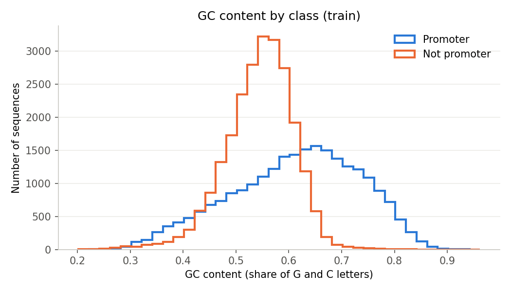
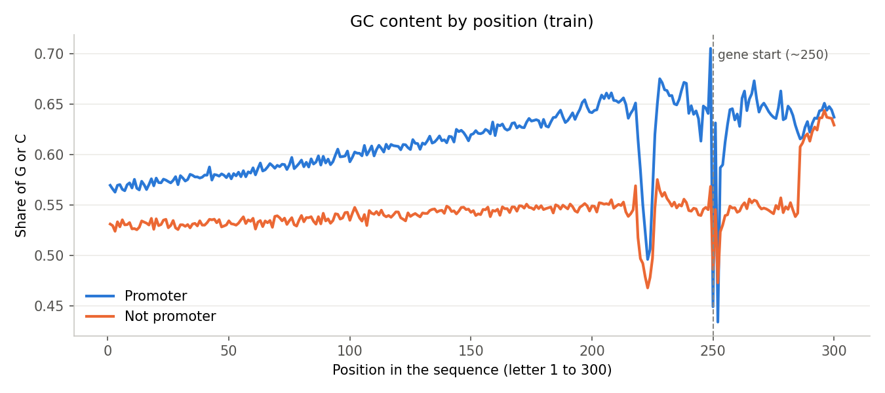

# EDA findings (step 1)

**Why:** GC content and the TATA box are two well-known signs of promoters, so I checked them after checking the data quality.

## Data check

| Split | Rows | Promoters | Length |
|---|---|---|---|
| Train | 47,356 | 50.0% | 300 |
| Dev | 5,920 | 49.8% | 300 |
| Test | 5,920 | 50.3% | 300 |

The data is balanced, and all sequences have 300 letters. They only use A, C, G and T, except for one unknown letter (N) in dev.

## GC content (Image 1)

Promoters have more G and C letters (61% on average) than non-promoters (54%). If a sequence has a lot of G and C (more than ~65%), it's probably a promoter. But many sequences are in the middle, so GC alone isn't enough.

## GC content by position (Image 2)

Promoters have more G and C everywhere, and even more near the gene start (letter ~250, according to the dataset documentation). The dip at ~220 is the TATA box area. Both classes look similar at a few spots (~220, ~250 and the last 15 letters). In 72.1% of non-promoters (17,065 of 23,684), the last 15 letters are exactly the same as a real promoter's last 15 letters.

## TATA box

In promoters, the TATA box usually starts at letter ~220 (about 530 cases), 30 letters before the gene start, as biology predicts. But non-promoters have it at letter ~219 even more often (about 330 cases at that exact spot), so a model can't rely on the TATA box alone.
