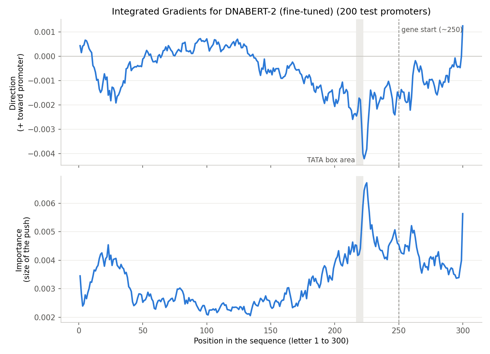
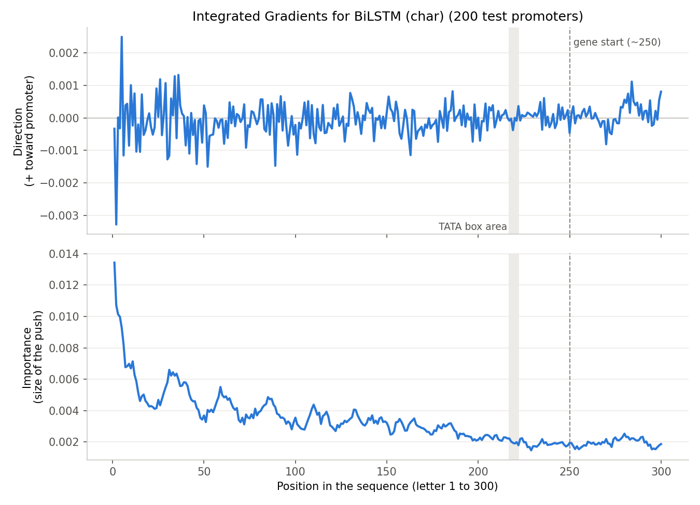

# Integrated Gradients findings (step 7)

**Why:** My models say "promoter" or "not promoter," but which letters drive that decision? Our proposal planned to check whether the best models focus on known promoter signals, like the TATA box.

## What I did

1. I took **200 test promoters** and explained my two best models: **DNABERT-2 fine-tuned (lr 5e-5)** and **BiLSTM (single letters)**.
2. **Integrated Gradients** starts from a **"blank" sequence** (every token replaced by padding for DNABERT-2, or by "unknown" for the BiLSTM). It then slowly fades in the real sequence in 50 steps and measures how much each token changes the model's score.
3. When a DNABERT-2 token covers several letters, I shared its score equally among those letters.
4. I scaled each sequence so they all count equally, then averaged the scores **by position** (letter 1 to 300).
5. I looked at two views:
   - **Direction:** above 0 pushes toward "promoter," and below 0 pushes away.
   - **Importance:** the size of the push, whatever the direction. This shows **where the model looks**.

## Baseline check

| Model | Average "promoter" probability: real promoters | Average "promoter" probability: blank sequence |
|---|---|---|
| DNABERT-2 fine-tuned | 0.905 | 0.994 |
| BiLSTM (single letters) | 0.868 | 0.993 |

**Both models score the blank sequence as almost surely a promoter.** Integrated Gradients measures the change from the blank to the real sequence, which here means going **down**. That's why the direction plots are mostly negative. **The importance view is the more reliable one.**

## DNABERT-2 (fine-tuned)

- **Top 10 positions by importance:** 225, 224, 223, 226, 222, 227, 300, 229, 260, 221.
- **The model looks most at the TATA box area (letters ~221–229)** and, in general, at the region **near the gene start (about letters 200–300)**. The middle of the sequence matters less.
- **At the TATA box area, the push is toward "not promoter"** (the deepest dip in the direction plot).

## BiLSTM (single letters)

- **Top 10 positions by importance:** letters 1 to 11.
- **The importance is highest at the first letters** and slowly goes down along the sequence.
- **The direction plot is noisy** around 0, with no clear pattern.

## Conclusions

1. **DNABERT-2 focuses on the region near the gene start, especially the TATA box area.** This matches my EDA, where promoters and non-promoters differ the most near the gene start.
2. **But at the TATA box area, DNABERT-2 pushes toward "not promoter."** This also matches my EDA: many non-promoters have the TATA pattern at letter ~219, even more often than promoters. *Hypothesis:* the model may be using **how the dataset was built**, not only biology.
3. **Both models think a blank sequence is a promoter.** *Hypothesis:* they mainly learned signs of "not promoter" (for example, the artifacts in the fake non-promoters), so with no evidence, they default to "promoter."
4. **The BiLSTM mostly reflects its own design.** It decides using its last "memory" in each direction, and the right→left memory ends at letter 1, so the first letters have the most direct influence. Integrated Gradients doesn't give a clear biological picture for this model.
5. **The proposal's expectation is only partly confirmed.** DNABERT-2 does focus on the TATA box area, but in the opposite direction from the simple biology story.

## Limitations

- **The blank baseline isn't neutral** (both models score it at about 0.99).
- **Averaging over 200 promoters can hide different patterns.** For example, promoters with and without a TATA box may behave differently.
- **I only explained promoters,** not non-promoters.
- **The hypotheses above are not tested.** Future work: try other baselines (like shuffled DNA), and explain promoters with and without a TATA box separately.
