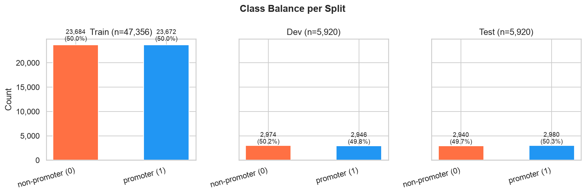
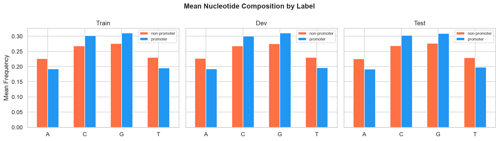
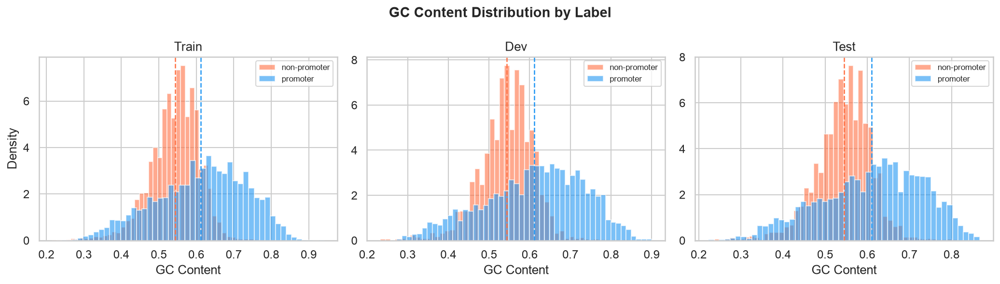
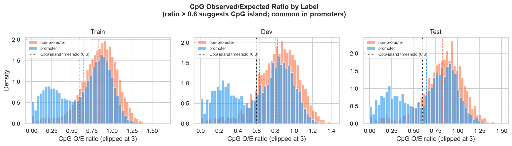
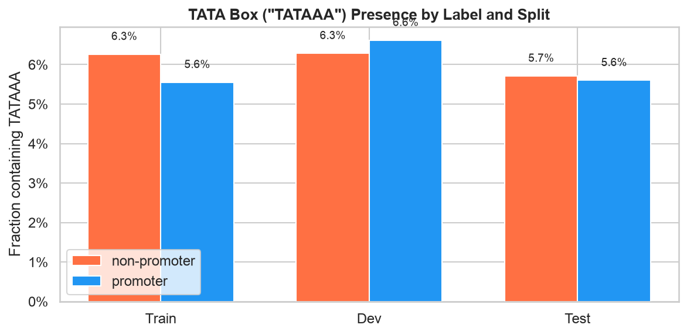
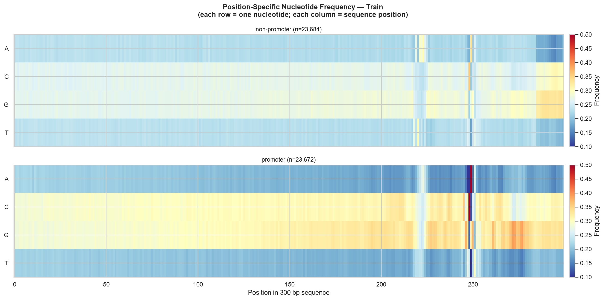
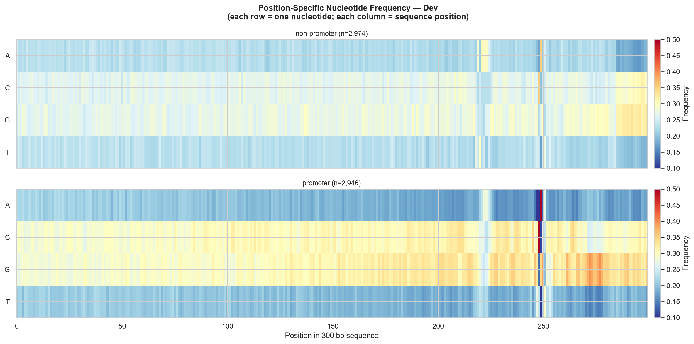
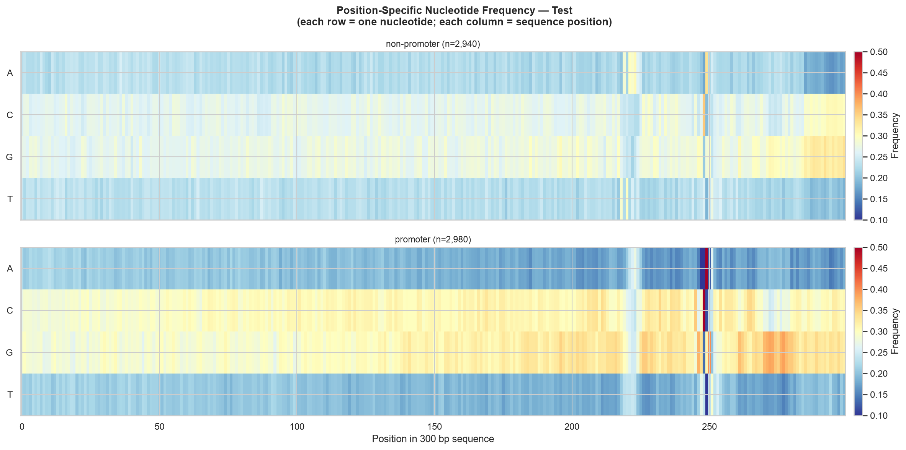
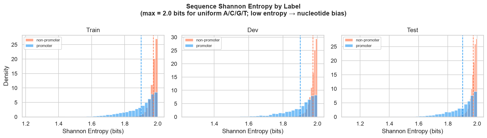

# EDA Plots — Promoter Detection Dataset Analysis

This directory contains exploratory data analysis (EDA) visualizations for the `prom_300_all` promoter detection dataset. Each plot was generated by `../eda.py` and reveals key characteristics distinguishing promoter sequences (label=1) from non-promoter sequences (label=0).

## Dataset Overview

- **Source**: `prom_300_all` dataset
- **Sequence length**: 300 bp (base pairs)
- **Labels**:
  - `1` = promoter (positive examples)
  - `0` = non-promoter (negative examples)
- **Splits**: train, dev, test

---

## Plots

### 01_class_balance.png

**What it shows**: Count and proportion of promoters vs. non-promoters in each split.

**Interpretation**:
- Reveals class imbalance in the dataset (e.g., more non-promoters than promoters)
- Important for understanding baseline accuracy and choosing appropriate evaluation metrics
- Helps identify if train/dev/test splits are stratified consistently

---

### 02_nucleotide_composition.png

**What it shows**: Mean frequency of each nucleotide (A, C, G, T) by label, across splits.

**Interpretation**:
- Promoter and non-promoter sequences have different nucleotide "signatures"
- Differences in nucleotide frequencies are potential discriminative features
- Consistent patterns across splits indicate robust biological differences
- Example: promoters may be G/C-rich or A/T-rich compared to non-promoters

---

### 03_gc_content.png

**What it shows**: Distribution of GC content (fraction of G+C bases) for each label.

**Interpretation**:
- GC content is a fundamental sequence property affecting DNA stability and function
- Histogram distributions show if promoters and non-promoters cluster at different GC levels
- Dashed line indicates mean GC content per class
- High separation between distributions suggests GC content is a useful feature

---

### 04_cpg_ratio.png

**What it shows**: CpG observed/expected ratio distribution (clipped at 3 for visualization).

**Interpretation**:
- **CpG ratio = (observed CpG count / sequence length) / (C frequency × G frequency)**
- Ratios > 0.6 indicate CpG islands, which are common in promoter regions
- Low CpG ratio suggests CpG suppression (typical in non-promoter DNA)
- Separation between promoter and non-promoter distributions indicates CpG enrichment is a strong promoter signal
- Example: promoters typically have higher CpG ratios, making this a discriminative feature

---

### 05_tata_box.png

**What it shows**: Fraction of sequences containing the TATA box motif (TATAAA) by label and split.

**Interpretation**:
- The TATA box is a canonical regulatory element in eukaryotic promoters
- Promoters should show higher TATA box prevalence than non-promoters
- Provides domain knowledge validation: if promoters don't have more TATA boxes, the dataset may be noisy or mislabeled
- May vary by split if splits differ in quality or organism

---

### 06_pos_nuc_train.png, 06_pos_nuc_dev.png, 06_pos_nuc_test.png

**What it shows**: Position-specific nucleotide frequency as a heatmap (4 nucleotides × 300 sequence positions).

**Train split:**

**Dev split:**

**Test split:**

**Interpretation**:
- Each row represents one nucleotide (A, C, G, T)
- Each column represents a position in the 300 bp sequence
- Color intensity indicates frequency (red = high, blue = low)
- Reveals sequence motifs: regions where certain nucleotides are enriched
- Promoters often show strong positional biases (e.g., specific motif at position 10-30)
- One heatmap per split allows checking consistency across train/dev/test

**Key observations**:
- Look for horizontal "bands" where one nucleotide dominates across all sequences
- Look for vertical "stripes" indicating position-specific preferences
- Promoters and non-promoters should show visibly different patterns

---

### 07_entropy.png

**What it shows**: Shannon entropy distribution of nucleotide composition by label.

**Interpretation**:
- **Shannon entropy** measures sequence complexity; max = 2.0 bits for uniform A/C/G/T
- Low entropy → strong nucleotide bias (repetitive, motif-rich sequences)
- High entropy → uniform nucleotide distribution (random-looking sequences)
- Promoters often have lower entropy due to conserved regulatory motifs
- Dashed line shows mean entropy per class
- Separation between distributions suggests entropy is a useful feature for classification

---

## Using These Plots

1. **Feature Engineering**: Insights from nucleotide composition, GC content, CpG ratio, and entropy inform feature selection for machine learning models
2. **Data Quality Check**: Differences between splits or anomalies may indicate data issues
3. **Model Interpretability**: EDA plots help explain model predictions (e.g., "this promoter has a high CpG ratio and TATA box")
4. **Baseline Understanding**: Before building models, understand the biological signals in the data

## Generated By

Script: `../eda.py`

Run `python ../eda.py` to regenerate all plots (requires data at `../data/prom_300_all/` with train.csv, dev.csv, test.csv).
